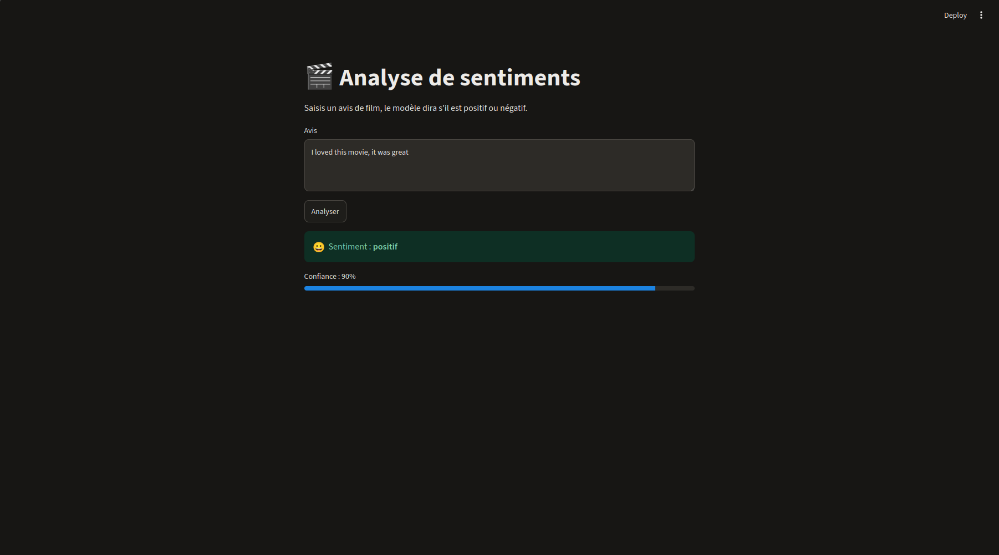
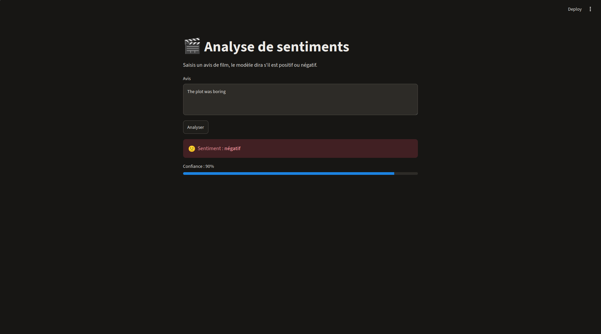
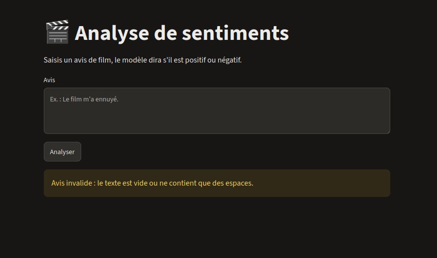

# Analyse de sentiments : avis de films IMDb
 
Ce projet classe un avis de film (en anglais) comme **positif** ou **négatif**.
Le modèle est un TF-IDF suivi d'une régression logistique (scikit-learn). Il est exposé par une API **FastAPI** et utilisé depuis une interface **Streamlit**.
 
Projet réalisé pendant le mini-hackathon Data & IA de HETIC (novembre 2026).
 
## Architecture
 
```
Streamlit (port 8501)  ──POST /predict──▶  FastAPI (port 8000)  ──▶  model/sentiment.joblib
```
 
## Structure du dépôt
 
```
.
├── api/                 # API FastAPI (main.py + Dockerfile)
├── app/                 # Interface Streamlit (streamlit_app.py + Dockerfile)
├── src/                 # Préparation des données et entraînement
├── data/imdb/           # Jeu de données IMDb
├── model/               # Modèle entraîné (sentiment.joblib)
├── notebooks/           # Exploration des données
├── tests/               # Tests pytest
├── docker-compose.yml
└── .github/workflows/   # CI GitHub Actions
```
 
## Données
 
Jeu utilisé : [Sentiment Labelled Sentences (UCI)](https://archive.ics.uci.edu/dataset/331/sentiment+labelled+sentences), fichier `imdb_labelled.txt` : 1 000 phrases issues d'avis IMDb, étiquetées 1 (positif) ou 0 (négatif).
 
- **Licence** : Creative Commons Attribution 4.0 (CC BY 4.0). Source à citer : Kotzias et al., *From Group to Individual Labels using Deep Features*, KDD 2015.
- **Nettoyage** : aucun avis vide, 3 doublons supprimés (« 10/10 », « Not recommended. »…), soit **997 avis**.
- **Répartition** : 499 négatifs / 498 positifs (équilibré).
- **Découpage** : 80 % entraînement (797 avis) / 20 % test (200 avis), stratifié, `random_state=42`.
 
## Prérequis
 
- Git
- Docker et Docker Compose
- Python 3.12 (uniquement pour lancer le projet sans Docker)
## Lancer le projet avec Docker (recommandé)
 
```bash
git clone https://github.com/Mahamane-223/Analyse-sentiment.git
cd Analyse-sentiment
docker compose up --build
```
 
- Interface : http://localhost:8501
- API et documentation Swagger : http://localhost:8000/docs
Pour arrêter : `Ctrl+C`, puis `docker compose down`.
 
## Lancer le projet sans Docker
 
```bash
python -m venv .venv
source .venv/bin/activate        # Windows : .venv\Scripts\activate
pip install -r requirements.txt -r app/requirements.txt
```
 
Ensuite, ouvrez deux terminaux à la racine du projet :
 
```bash
# Terminal 1 : l'API
uvicorn api.main:app --reload
 
# Terminal 2 : l'interface
streamlit run app/streamlit_app.py
```
 
## Utiliser l'API
 
| Route | Entrée | Sortie |
|---|---|---|
| `GET /health` | — | `{"status": "ok"}` |
| `POST /predict` | `{"text": "I loved this movie"}` | `{"label": "positif", "proba": 0.91}` |
 
Un texte vide ou composé d'espaces renvoie une erreur **HTTP 422**.
 
Exemple d'avis valide :
 
```bash
curl -X POST http://localhost:8000/predict \
     -H "Content-Type: application/json" \
     -d '{"text": "I loved the ending."}'
```
 
Exemple d'avis invalide, qui renvoie 422 :
 
```bash
curl -X POST http://localhost:8000/predict \
     -H "Content-Type: application/json" \
     -d '{"text": "   "}'
```
 
## Captures d'écran
 
| Avis positif | Avis négatif | Avis vide (422) |
|---|---|---|
|  |  |  |
 
## Tests et intégration continue
 
```bash
pytest -v
```
 
À chaque push, GitHub Actions (`.github/workflows/ci.yml`) lance `pytest` et vérifie que les images Docker se construisent.
 
## Résultats et limites
 
### Résultats

Entraînement : `python src/train.py` (les scores sont aussi enregistrés dans `model/metrics.json`).

| Modèle | F1 macro |
|---|---|
| Baseline (classe majoritaire) | 0,333 |
| TF-IDF mots seuls + régression logistique (validation croisée 5 plis) | 0,767 |
| TF-IDF mots + bigrammes + régression logistique (validation croisée 5 plis) | 0,759 |
| **Modèle retenu (mots seuls), sur le jeu de test** | **0,799** |

Les bigrammes n'améliorent pas le score : les avis sont trop courts (14 mots en moyenne) pour que les paires de mots se répètent assez.

Matrice de confusion (jeu de test, 200 avis) :

| | Prédit négatif | Prédit positif |
|---|---|---|
| **Vrai négatif** | 75 | 25 |
| **Vrai positif** | 15 | 85 |

Le modèle se trompe plus souvent sur les avis négatifs : quand il hésite, il a tendance à répondre « positif ».

### Limites

Exemples réels d'erreurs sur le jeu de test :

| Type d'erreur | Avis | Vrai | Prédit |
|---|---|---|---|
| Négation | « It is not good. » | négatif | positif |
| Négation | « Predictable, but not a bad watch. » | positif | négatif |
| Ironie | « All in all, a great disappointment. » | négatif | positif |
| Avis très court | « Hated it. » | négatif | positif |
| Vocabulaire inconnu | « In fact, this stinker smells like a direct-to-video release. » | négatif | positif |

- **Négations** : le modèle regarde les mots un par un. Dans « not good », il voit « good » et pense que c'est positif.
- **Ironie** : un mot positif utilisé de façon ironique (« great disappointment ») trompe le modèle.
- **Avis très courts** : avec 1 ou 2 mots, le modèle a très peu d'indices, surtout si le mot n'apparaît pas dans les données d'entraînement.
- **Peu de données** : 797 avis d'entraînement seulement, donc beaucoup de mots n'ont jamais été vus.
- **Domaine limité** : le modèle a appris sur des avis de films en anglais. Il n'est pas fiable sur d'autres sujets ou dans d'autres langues.
## Équipe
 
| Rôle | Responsabilités |
|---|---|
| Data et cheffe de projet | données, évaluation, gestion du repo |
| Data 2 | entraînement du modèle, limites |
| Dev 1 | API FastAPI, tests pytest |
| Dev 2 | interface Streamlit, Docker, CI, README |